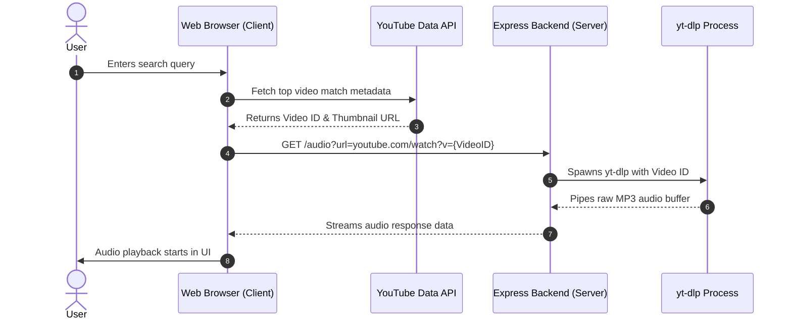

# High-Level Design (HLD) - Spotify Clone

This High-Level Design (HLD) document outlines the system architecture, technology stack, data flows, and deployment setup for the Spotify Clone application.

---

## 1. System Architecture

The Spotify Clone is built as a lightweight client-server application designed to play local files and stream external YouTube audio on demand.

```
+------------------+                   +------------------+
|                  |   Search request  |                  |
|  Client Browser  |------------------>|   YouTube API    |
| (HTML, CSS, JS)  |<------------------|                  |
|                  |   Video metadata  |                  |
+------------------+                   +------------------+
         |                                       ^
         | Stream request                        |
         | /audio?url=...                        |
         v                                       |
+------------------+                             |
|  Express Server  |                             |
| (localhost:5500) |-----------------------------+
|                  |   Spawns yt-dlp to stream audio
+------------------+
```

### Components
1. **Frontend Application**: Running in the user's web browser. It displays the UI, handles user input, communicates with the YouTube API to fetch video lists, and manages audio playback using the standard HTML5 Audio element.
2. **Express Server Proxy**: Running locally on Node.js. It acts as an intermediary, taking YouTube video URLs, fetching the raw audio streams using `yt-dlp`, and piping them to the client. This bypasses browser CORS restrictions and avoids loading heavy video elements.

---

## 2. Technology Stack

- **Client Environment**: HTML5, CSS3, JavaScript (ES6 modules).
- **Icons & Graphics**: FontAwesome v6, Lottie-web CDN.
- **Backend Application**: Node.js, Express.js, CORS.
- **Streaming Tool**: `yt-dlp` (spawned as a backend child process).
- **APIs**: YouTube Data API v3, Spotify Web API (placeholder client credentials).

---

## 3. Core Data Flow: Search & Play



---

## 4. Deployment Flow & Environment Configuration

### Local Setup
1. Clone the project repository.
2. Install dependencies: Run `npm install`.
3. Install external tools: Ensure `yt-dlp` is installed and added to the host environment PATH.
4. Run server: Start the Express server by running `npm start` (port 5500).
5. Open browser: Visit `http://localhost:5500` to access the interface.

---

## 5. Future Scalability Improvements

To scale this application for production use:
1. **Caching and CDNs**: Deploy a Redis layer on the backend to cache YouTube video stream URLs, reducing repetitive queries and extraction times.
2. **Serverless Deployment**: Split the backend streaming endpoint into standalone serverless functions (like AWS Lambda or Google Cloud Functions) to handle scaling.
3. **Database Integration**: Implement a database (such as MongoDB or Supabase) to save custom user playlists, rather than storing them in local client-side arrays.
