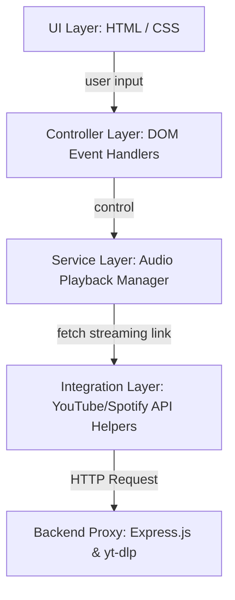
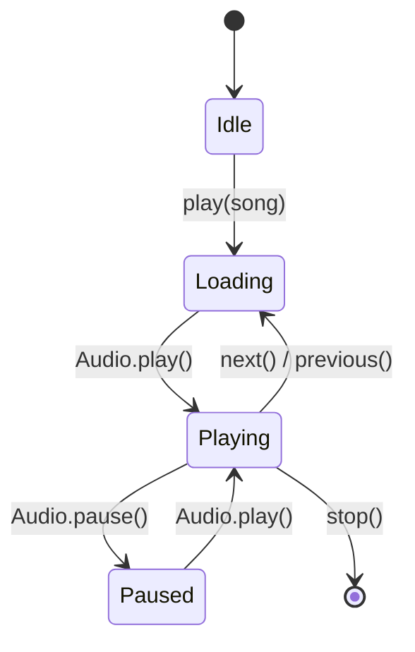

# Low-Level Design (LLD) - Spotify Clone

This Low-Level Design (LLD) document describes the internal modules, database models, event handlers, and data flows of the Spotify Clone.

---

## 1. Application Layers

### Front-End Layers
- **Presentation Layer (`index.html` / `style.css`)**: Implements grid layouts and structures for pages, control buttons, progress bars, and visualizers.
- **Controller/Interaction Layer (`script.js` Event Handlers)**: Captures click, search, and drag events from the DOM and routes them to appropriate service functions.
- **Audio Service Layer (`currentAudio` wrappers)**: Manages audio state changes, play/pause controls, seek positioning, volume levels, and updates Lottie visualizers.
- **API Client Layer (`Fetch_Youtube_music.js` & `spotifyAPI.js`)**: Communicates with external APIs and backend proxy endpoints.

### Back-End Layers
- **Router Layer (`server.js` Routes)**: Handles static file serving and routes request queries to the streaming service.
- **Streaming Service Layer (`yt-dlp` child process)**: Spawns processes to convert YouTube streams into output buffers and pipes them back to client requests.

---

## 2. Component Diagram & State Flows

### Component Interactions
- **Sidebar List**: Interacts with the global player by changing playlists and loading lists of songs into detail tables.
- **Dashboard Cards**: Interacts with the playback controller to play selected tracks immediately.
- **Search Bar**: Interacts with the search handler, which queries the API, switches the main dashboard display panel, and updates playback with the new track.
- **Bottom Media Tray**: Direct listener of the active HTML Audio element (`currentAudio`). It updates progress markers and tracks play/pause statuses.

### Global Player States

---

## 3. Core Logic & Event Flows

### Dynamic Audio Streaming Flow
1. **Search Request**: The user enters a track title in the search field.
2. **Video Lookup**: The client queries the YouTube Data API to find the most relevant video ID.
3. **Link Generation**: The client sets the source of the `Audio` instance to the backend proxy URL:
   `http://localhost:5500/audio?url=https://www.youtube.com/watch?v={videoId}`
4. **Backend Audio Extraction**: The Express backend receives the video URL, spawns `yt-dlp`, and pipes the extracted MP3 audio stream back to the browser.
5. **Playback**: The browser's HTML Audio player reads the incoming stream buffer and plays it.

---

## 4. Reusable Modules
- **Audio Player Class (Proposed)**: Manages state variables (`currentTime`, `duration`, `volume`, `isPlaying`) and updates track playback and UI visualizers in sync.
- **API Service Class (Proposed)**: Handles search API queries, backend proxy calls, and implements simple query caching.
- **UI Renderer Module (Proposed)**: Manages UI view switching and handles playlist and search result table generation dynamically.
